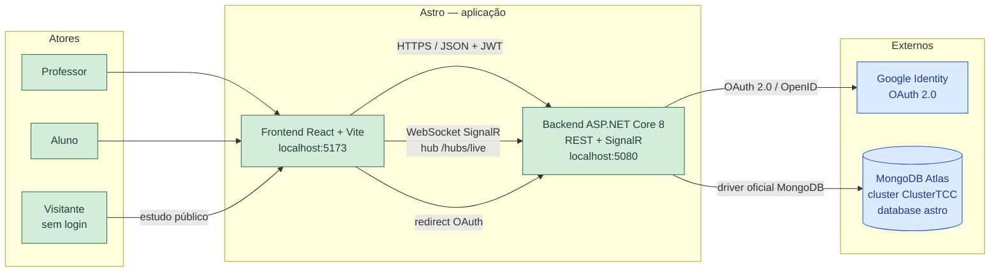
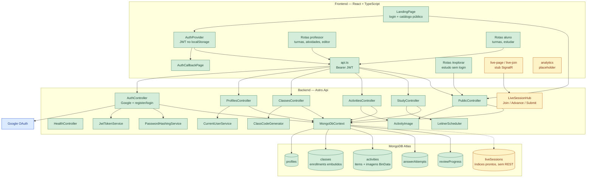
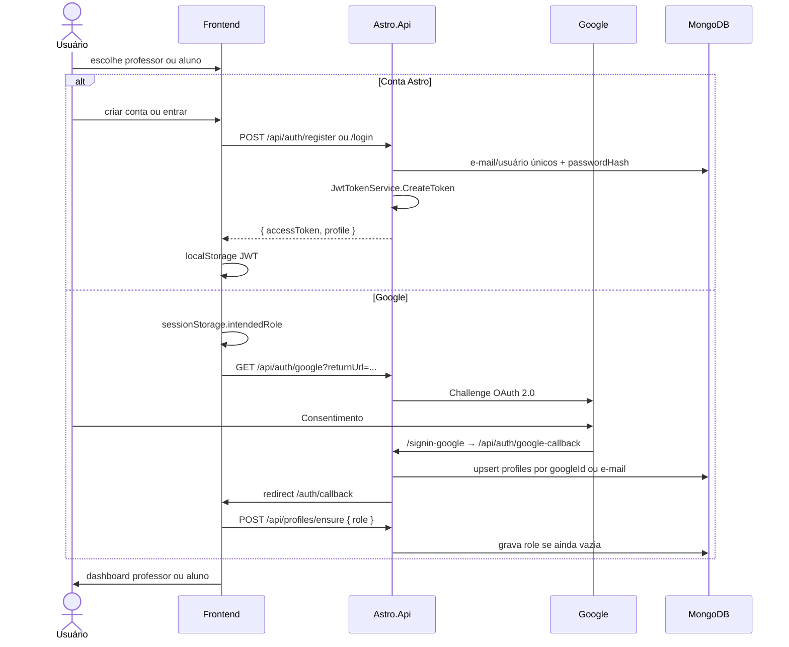
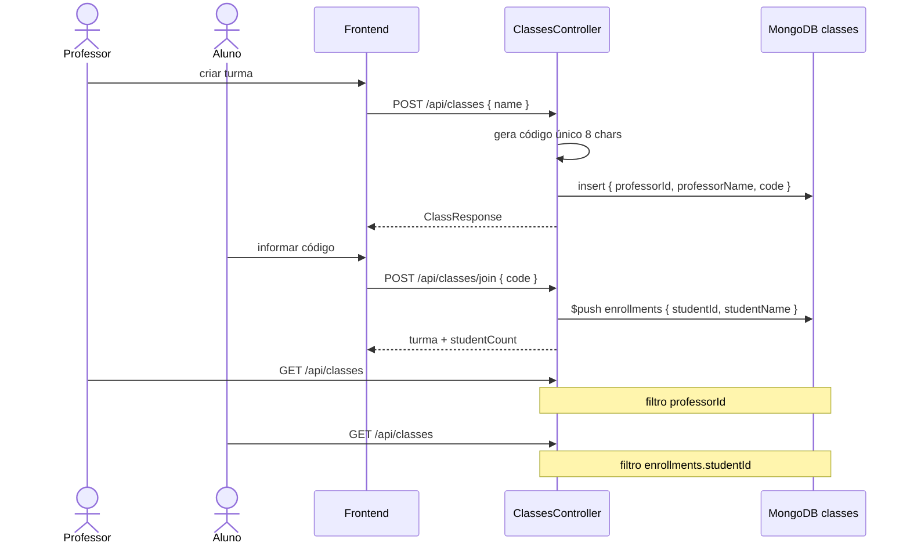
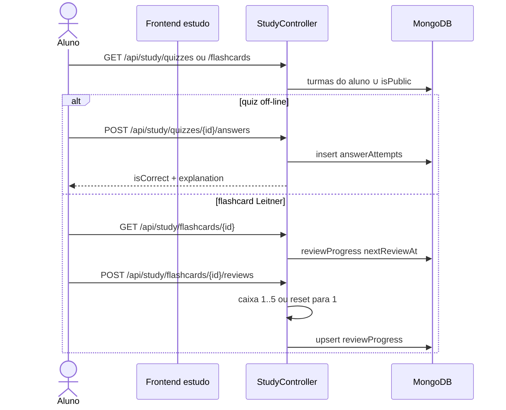
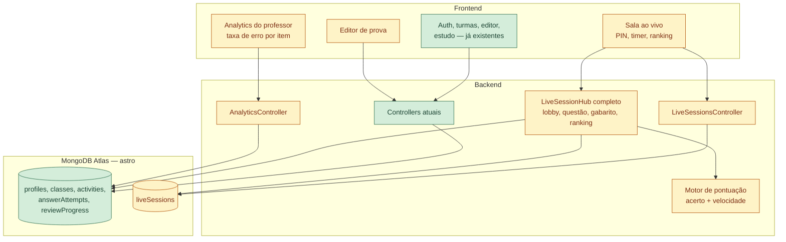
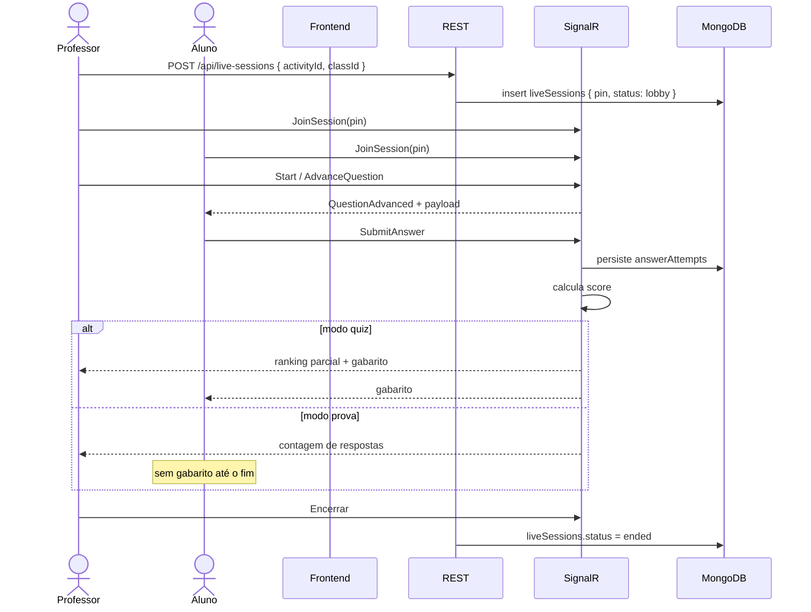
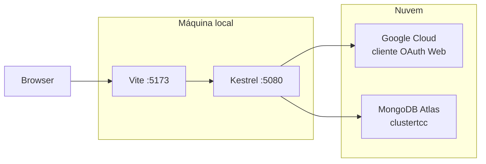

# Diagrama de arquitetura — Astro

Documento da arquitetura do sistema na **versão atual** (implementada) e na **versão futura** (próximas entregas do TCC).

Legenda usada nos diagramas:

- **Verde** — já implementado e em uso
- **Âmbar** — modelado ou com stub; ainda não é fluxo completo
- **Azul** — serviço externo

---

## 1. Visão de contexto (atual e futura)

O Astro é um ambiente híbrido: o professor conduz sessões ao vivo (estilo Kahoot) e o aluno também estuda no próprio ritmo (quizzes e flashcards). Visitantes sem conta podem estudar conteúdo **público** na página inicial.



---

## 2. Arquitetura atual — componentes

Operacional hoje: login Google **ou** conta Astro (e-mail, senha e nome de usuário), turmas, biblioteca de quizzes/flashcards (CRUD, imagens comprimidas, público/privado), estudo off-line autenticado e estudo público anônimo. O hub SignalR e o analytics ainda são stubs.



### Endpoints e telas atuais

| Camada | Implementado | Ainda stub / placeholder |
|---|---|---|
| Auth | `POST /api/auth/register`, `POST /api/auth/login`, `GET /api/auth/google`, callback, JWT | — |
| Perfil | `GET /api/profiles/me`, `POST /api/profiles/ensure` | — |
| Turmas | listar, detalhe, criar, ingressar por código | — |
| Atividades | CRUD quiz/flashcards, imagens, `isPublic`, vínculo N turmas, importar flashcards | tipo `prova` e `kind` V/F ainda não no editor |
| Estudo autenticado | `GET/POST /api/study/quizzes`, `GET/POST /api/study/flashcards` (Leitner) | — |
| Estudo público | `GET /api/public/activities`, respostas e decks anônimos | — |
| Ao vivo | hub `JoinSession`, `AdvanceQuestion`, `SubmitAnswer` | sem persistência, sem pontuação, sem ranking |
| Analytics | rota de UI | sem agregação real |

---

## 3. Sequência atual — autenticação

Duas entradas: **Google** ou **conta Astro**. O papel (professor/aluno) é escolhido na landing e fica fixo na primeira gravação do perfil.



---

## 4. Sequência atual — turmas



---

## 5. Sequência atual — atividades e visibilidade

```mermaid
sequenceDiagram
  actor P as Professor
  actor A as Aluno
  actor V as Visitante
  participant FE as Frontend
  participant API as REST
  participant DB as MongoDB activities

  P->>FE: criar/editar quiz ou flashcards
  FE->>FE: comprime imagens no canvas
  FE->>API: POST/PUT /api/activities { items, isPublic }
  API->>API: valida itens + tamanho BSON menor que 16 MB
  API->>DB: activities com items e imageBytes
  P->>API: PUT /api/activities/{id}/classes
  API->>DB: classIds[]

  alt Privado
    A->>API: GET /api/study/...
    Note over API,DB: só se matriculado na turma vinculada
  else Público
    V->>FE: seção Estudo público na landing
    FE->>API: GET /api/public/activities
    V->>API: GET /api/public/activities/{id}
    Note over API: gabarito só após responder; sem persistir tentativa
  end
```

---

## 6. Sequência atual — estudo assíncrono (aluno logado)



---

## 7. Arquitetura futura — o que ainda falta

A stack permanece a mesma. Entram sessão ao vivo completa, tipo prova, analytics e pontuação em tempo real.



### Módulos futuros (requisitos do TCC ainda abertos)

| Módulo | Comportamento previsto |
|---|---|
| Prova | Tipo `prova`; sem ranking/gabarito durante a aplicação; nota só por acertos |
| Ao vivo — quiz | PIN 6 dígitos, pontuação por acerto e velocidade, ranking e gabarito |
| Analytics | Índice de erros por questão; destaque se erro > 50% |

---

## 8. Sequência futura — sessão ao vivo



---

## 9. Implantação atual (desenvolvimento)



A versão futura mantém os mesmos três blocos. O que muda é o hub ao vivo, o analytics e o uso efetivo de `liveSessions`.
