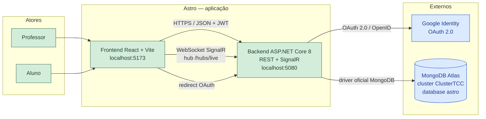
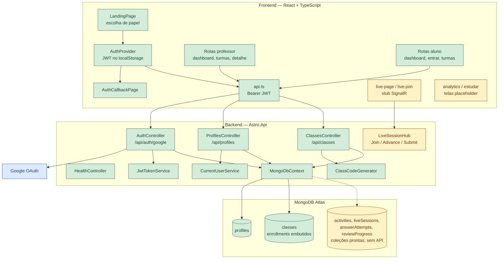
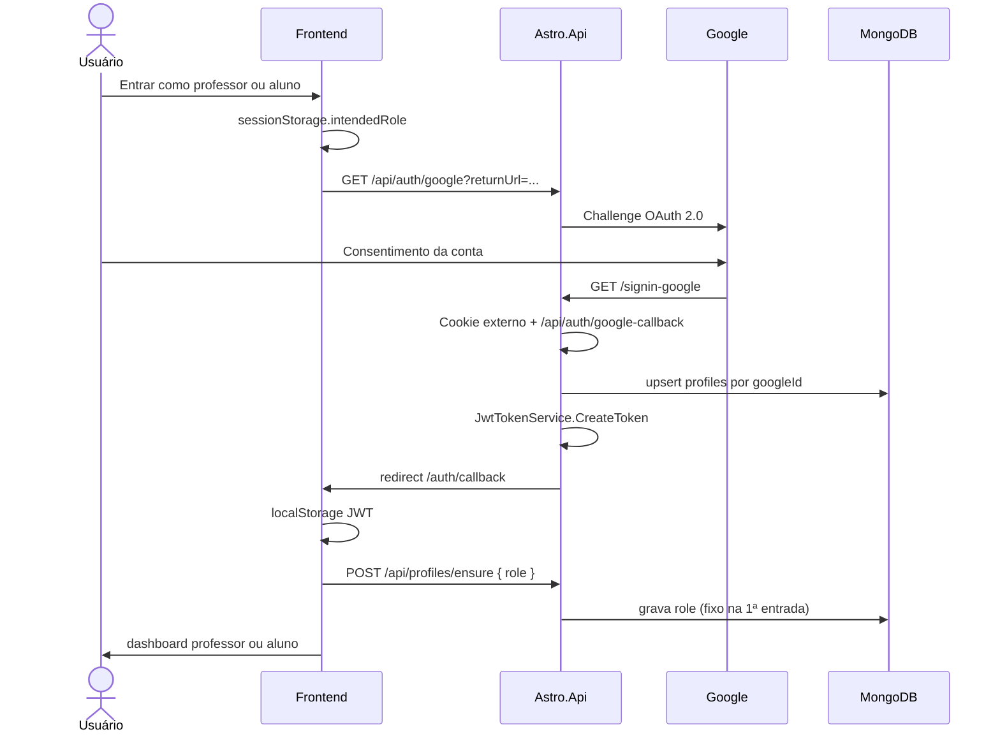
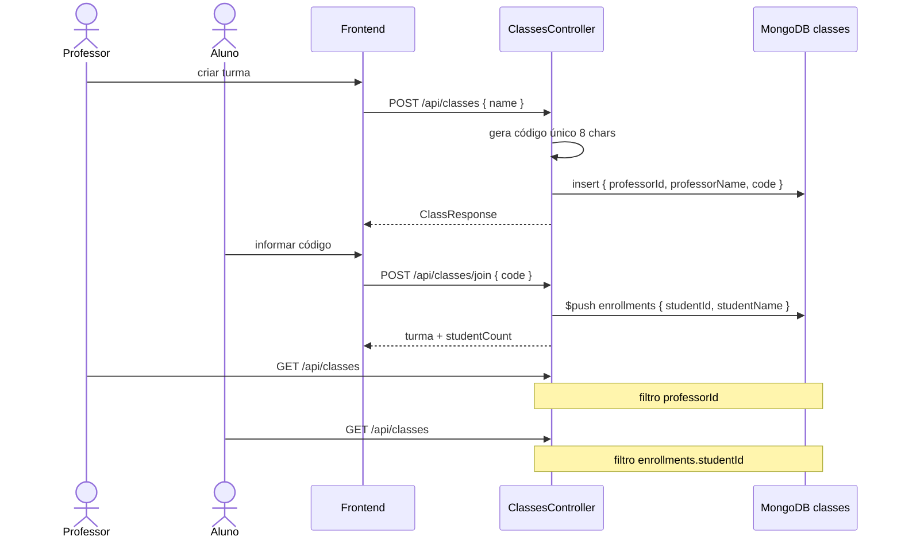
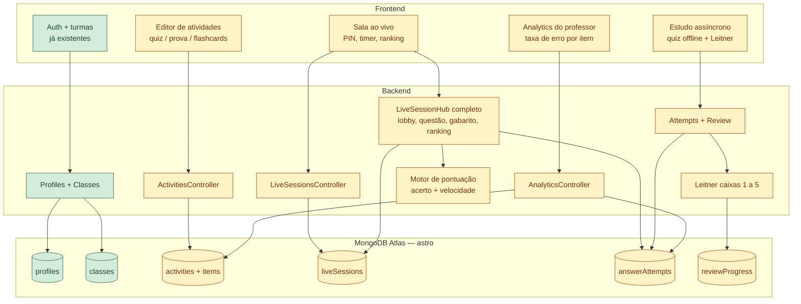
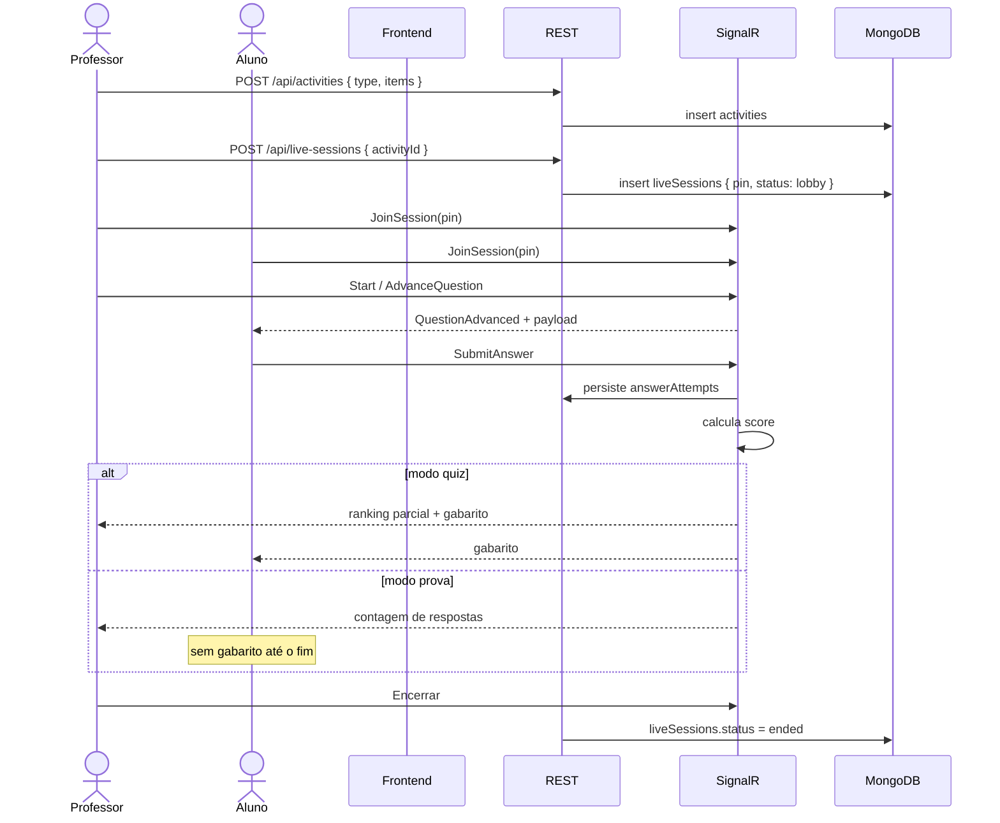
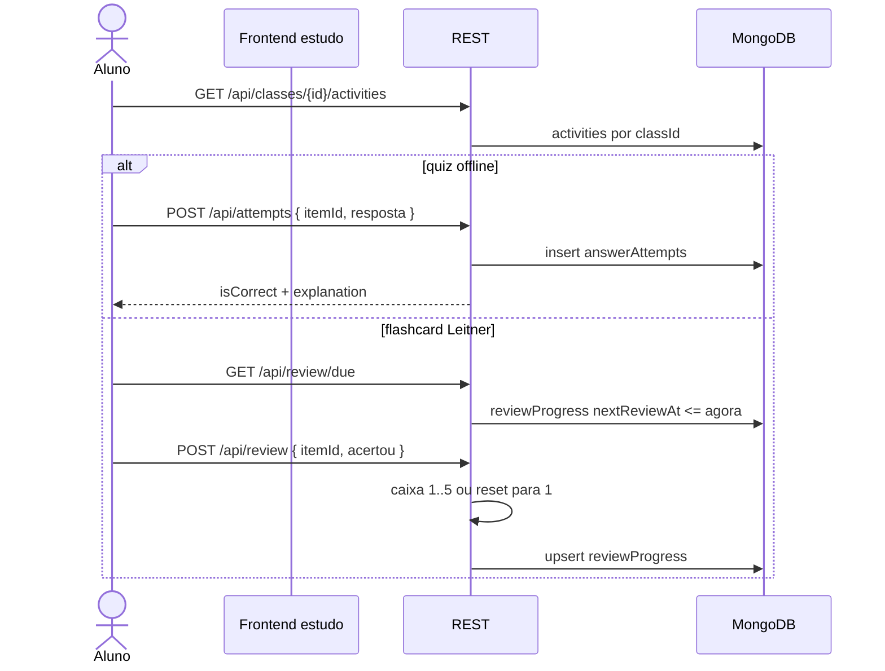
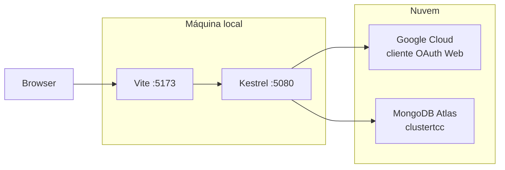

# Diagrama de arquitetura — Astro

Documento da arquitetura do sistema na **versão atual** (implementada) e na **versão futura** (próximas entregas do TCC).

Legenda usada nos diagramas:

- **Verde** — já implementado e em uso
- **Âmbar** — modelado ou com stub; ainda não é fluxo completo
- **Azul** — serviço externo

---

## 1. Visão de contexto (atual e futura)

O Astro é um ambiente híbrido: o professor conduz sessões ao vivo (estilo Kahoot) e o aluno também estuda no próprio ritmo (quizzes e flashcards).

---

## 2. Arquitetura atual — componentes

O que está operacional hoje: autenticação Google, perfil fixo (professor/aluno) e gestão de turmas. O hub SignalR existe, mas a sessão ao vivo ainda é um stub (PIN + grupo, sem persistir atividade nem pontuar).

### Endpoints e telas atuais

| Camada | Implementado | Ainda stub / placeholder |
|---|---|---|
| Auth | `GET /api/auth/google`, callback, JWT | — |
| Perfil | `GET /api/profiles/me`, `POST /api/profiles/ensure` | — |
| Turmas | listar, detalhe, criar, ingressar por código | — |
| Ao vivo | hub `JoinSession`, `AdvanceQuestion`, `SubmitAnswer` | sem persistência, sem pontuação, sem ranking |
| Atividades | modelo no domínio | sem controller REST |
| Estudo / analytics | rotas de UI | sem dados reais |

---

## 3. Sequência atual — login com Google

---

## 4. Sequência atual — turmas

---

## 5. Arquitetura futura — componentes

A stack permanece a mesma. Entram os módulos de conteúdo polimórfico, sessão ao vivo completa, estudo assíncrono (Leitner) e analytics.

### Módulos futuros (requisitos do TCC)

| Módulo | Comportamento previsto |
|---|---|
| Atividades | Professor cria quiz, prova ou flashcards; itens polimórficos (`kind`) |
| Questões | Múltipla escolha (2–5, 1 correta), V/F, tempo padrão 30 s |
| Ao vivo — quiz | PIN 6 dígitos, pontuação por acerto e velocidade, ranking e gabarito |
| Ao vivo — prova | Sem ranking/gabarito durante a aplicação; nota só por acertos |
| Estudo assíncrono | Feedback imediato; flashcards Leitner (acerto avança, erro volta à caixa 1) |
| Analytics | Índice de erros por questão; destaque se erro > 50% |

---

## 6. Sequência futura — sessão ao vivo

---

## 7. Sequência futura — estudo assíncrono

---

## 8. Implantação atual (desenvolvimento)

A versão futura mantém os mesmos três blocos. O que muda é o conjunto de APIs e o uso efetivo das coleções já previstas no Atlas.
