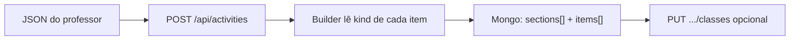

# Criar atividades pelo JSON

Corpo de `CreateActivityRequest` (camelCase) em `POST /api/activities`. JWT de professor. O mesmo JSON vale no `PUT /api/activities/{id}` (o `type` não pode mudar).

Envelope:

```json
{
  "title": "Título da atividade",
  "type": "quiz",
  "isPublic": false,
  "items": [],
  "sections": []
}
```

| Campo | Obrigatório | Valores |
|---|---|---|
| `title` | sim | 2–200 caracteres |
| `type` | sim | só `"quiz"` ou `"flashcards"` |
| `isPublic` | não | `false` por padrão; `true` entra no catálogo da landing |
| `items` | um dos dois | lista plana; o builder cria prep / practice / feedback |
| `sections` | um dos dois | se vier preenchido, **ganha** de `items` na raiz |

Turmas **não** vão neste POST. Depois: `PUT /api/activities/{id}/classes` com `{ "classIds": ["…"] }`.



---

## 1. Formato curto — só `items` (o backend monta as seções)

Use quando não precisa de texto de preparação. O builder gera `prep` vazio, `practice` com todos os itens e `feedback` com `score_summary`.

```json
{
  "title": "Sistema Solar — revisão rápida",
  "type": "quiz",
  "isPublic": true,
  "items": [
    {
      "kind": "multiple_choice",
      "prompt": "Qual o maior planeta do Sistema Solar?",
      "explanation": "Júpiter é um gigante gasoso.",
      "timeLimitSeconds": 30,
      "options": [
        { "text": "Marte", "isCorrect": false },
        { "text": "Júpiter", "isCorrect": true },
        { "text": "Saturno", "isCorrect": false }
      ]
    }
  ]
}
```

O que o servidor grava a mais: `id` em cada item e opção, `position`, `sectionId`, três seções, `professorId`, `createdAt`. Timer omitido vira **30**.

---

## 2. Formato completo — `sections` (prep + prática + feedback)

`items` na raiz é ignorado se `sections` tiver elementos. Só `practice` pode ter questões.

```json
{
  "title": "Sistema Solar",
  "type": "quiz",
  "isPublic": false,
  "sections": [
    {
      "role": "prep",
      "title": "Antes de começar",
      "body": "Revise a ordem dos planetas a partir do Sol.",
      "objectives": ["Identificar os planetas", "Distinguir interno e externo"],
      "estimatedMinutes": 10,
      "tips": ["Leia o enunciado até o fim", "Nas lacunas, acentos não importam se caseSensitive for false"]
    },
    {
      "role": "practice",
      "title": "Questões",
      "items": []
    },
    {
      "role": "feedback",
      "title": "Resultados",
      "feedbackTemplate": "score_summary"
    }
  ]
}
```

`feedbackTemplate`: `score_summary`, `explanations` ou `due_cards` (este último faz mais sentido em flashcards). Faltar prep ou feedback: o builder completa.

Os itens de cada kind entram em `sections[1].items`. Os blocos abaixo são recortes prontos para colar aí.

---

## 3. Múltipla escolha — `multiple_choice`

Uma alternativa correta. 2 a 6 opções.

```json
{
  "kind": "multiple_choice",
  "prompt": "Qual o maior planeta do Sistema Solar?",
  "explanation": "Júpiter é um gigante gasoso.",
  "timeLimitSeconds": 30,
  "allowMultiple": false,
  "options": [
    { "text": "Terra", "isCorrect": false },
    { "text": "Júpiter", "isCorrect": true },
    { "text": "Netuno", "isCorrect": false },
    { "text": "Vênus", "isCorrect": false }
  ]
}
```

Várias corretas: `"allowMultiple": true` e pelo menos uma `isCorrect: true`.

```json
{
  "kind": "multiple_choice",
  "prompt": "Quais são planetas gasosos?",
  "allowMultiple": true,
  "options": [
    { "text": "Júpiter", "isCorrect": true },
    { "text": "Marte", "isCorrect": false },
    { "text": "Saturno", "isCorrect": true },
    { "text": "Mercúrio", "isCorrect": false }
  ]
}
```

---

## 4. Verdadeiro ou falso — `true_false`

Forma curta: o builder gera as opções “Verdadeiro” e “Falso”.

```json
{
  "kind": "true_false",
  "prompt": "Marte é um planeta interno.",
  "correctTrue": true,
  "explanation": "Mercúrio, Vênus, Terra e Marte são os planetas internos."
}
```

Forma explícita (exatamente duas opções, uma correta):

```json
{
  "kind": "true_false",
  "prompt": "Plutão é classificado como planeta anão.",
  "options": [
    { "text": "Verdadeiro", "isCorrect": true },
    { "text": "Falso", "isCorrect": false }
  ]
}
```

---

## 5. Resposta curta — `short_answer`

O aluno digita texto. Qualquer string de `acceptedAnswers` vale. `caseSensitive: false` (padrão) ignora maiúsculas.

```json
{
  "kind": "short_answer",
  "prompt": "Qual o satélite natural da Terra?",
  "acceptedAnswers": ["Lua", "A Lua", "lua"],
  "caseSensitive": false,
  "explanation": "A Lua é o único satélite natural da Terra."
}
```

---

## 6. Associação — `matching`

Pelo menos **dois** pares. O aluno liga esquerda com direita; o gabarito é o par `left`/`right` de cada objeto. `id` dos lados é gerado se omitido.

```json
{
  "kind": "matching",
  "prompt": "Associe o planeta à característica.",
  "pairs": [
    { "left": "Júpiter", "right": "Maior planeta" },
    { "left": "Marte", "right": "Planeta vermelho" },
    { "left": "Saturno", "right": "Anéis visíveis" },
    { "left": "Vênus", "right": "Mais quente" }
  ]
}
```

---

## 7. Ordenação — `ordering`

Pelo menos **três** itens. A **ordem do array é o gabarito** (`position` 0, 1, 2…). Na tela o aluno recebe a lista embaralhada.

```json
{
  "kind": "ordering",
  "prompt": "Ordene os planetas a partir do Sol.",
  "orderEntries": [
    { "text": "Mercúrio" },
    { "text": "Vênus" },
    { "text": "Terra" },
    { "text": "Marte" }
  ]
}
```

---

## 8. Lacuna — `cloze`

No `prompt`, cada `{{resposta}}` vira uma lacuna. Várias aceitas na mesma lacuna: `{{Lua|a Lua}}`.

```json
{
  "kind": "cloze",
  "prompt": "A Terra é o {{terceiro|3º}} planeta a partir do Sol e tem um satélite chamado {{Lua|a Lua}}.",
  "caseSensitive": false,
  "explanation": "Ordem: Mercúrio, Vênus, Terra."
}
```

Opcional: `clozeBlanks` com `acceptedAnswers` extra (o builder **une** com o texto dentro de `{{…}}`). Sem `{{…}}` no enunciado a validação falha.

---

## 9. Categorias — `categorize`

Pelo menos **duas** categorias e **três** itens. Cada item precisa de `categoryId` igual ao `id` da categoria (Guid). Gere os ids no cliente, como o editor faz.

```json
{
  "kind": "categorize",
  "prompt": "Classifique os planetas.",
  "categories": [
    { "id": "11111111-1111-1111-1111-111111111111", "label": "Interno" },
    { "id": "22222222-2222-2222-2222-222222222222", "label": "Externo" }
  ],
  "categoryItems": [
    { "text": "Mercúrio", "categoryId": "11111111-1111-1111-1111-111111111111" },
    { "text": "Terra", "categoryId": "11111111-1111-1111-1111-111111111111" },
    { "text": "Júpiter", "categoryId": "22222222-2222-2222-2222-222222222222" },
    { "text": "Netuno", "categoryId": "22222222-2222-2222-2222-222222222222" }
  ]
}
```

---

## 10. Deck de flashcards — `type: flashcards`

Cada item é `kind: flashcard` com `front` e `back`. Sem timer. O builder ainda cria as três seções; o feedback típico é `due_cards` (Leitner).

```json
{
  "title": "Vocabulário — Sistema Solar",
  "type": "flashcards",
  "isPublic": false,
  "sections": [
    {
      "role": "prep",
      "title": "Como revisar",
      "body": "Marque se lembrou do verso. O Astro usa caixas Leitner (1 a 5).",
      "estimatedMinutes": 8
    },
    {
      "role": "practice",
      "items": [
        {
          "kind": "flashcard",
          "front": "Fotossíntese",
          "back": "Conversão de luz em energia química"
        },
        {
          "kind": "flashcard",
          "front": "Planeta anão",
          "back": "Corpo que orbita o Sol, quase esférico, mas não limpou a vizinhança (ex.: Plutão)"
        }
      ]
    },
    {
      "role": "feedback",
      "title": "Fila de revisão",
      "feedbackTemplate": "due_cards"
    }
  ]
}
```

Atalho sem seções:

```json
{
  "title": "Vocabulário — cap. 2",
  "type": "flashcards",
  "items": [
    { "kind": "flashcard", "front": "AU", "back": "Unidade astronômica: distância média Terra–Sol" }
  ]
}
```

Outro caminho: `POST /api/activities/{idDoQuiz}/import-flashcards` gera um deck a partir de um quiz existente (`sourceActivityId`).

---

## 11. Quiz completo — todos os kinds numa atividade

Um único `POST`. Os `id` de categorize são estáveis só neste exemplo.

```json
{
  "title": "Sistema Solar — atividade completa",
  "type": "quiz",
  "isPublic": false,
  "sections": [
    {
      "role": "prep",
      "title": "Contexto",
      "body": "Conteúdo do 6º ano: planetas, ordem a partir do Sol e classificação.",
      "objectives": ["Reconhecer planetas", "Ordenar a partir do Sol"],
      "estimatedMinutes": 15,
      "tips": ["Nas lacunas, sinônimos estão entre |"]
    },
    {
      "role": "practice",
      "title": "Prática",
      "items": [
        {
          "kind": "multiple_choice",
          "prompt": "Qual o maior planeta?",
          "timeLimitSeconds": 30,
          "options": [
            { "text": "Marte", "isCorrect": false },
            { "text": "Júpiter", "isCorrect": true }
          ]
        },
        {
          "kind": "true_false",
          "prompt": "A Terra é um planeta interno.",
          "correctTrue": true
        },
        {
          "kind": "short_answer",
          "prompt": "Nome do satélite natural da Terra",
          "acceptedAnswers": ["Lua", "A Lua"]
        },
        {
          "kind": "matching",
          "prompt": "Associe planeta e apelido.",
          "pairs": [
            { "left": "Marte", "right": "Planeta vermelho" },
            { "left": "Júpiter", "right": "Gigante gasoso" }
          ]
        },
        {
          "kind": "ordering",
          "prompt": "Do mais próximo ao mais distante do Sol.",
          "orderEntries": [
            { "text": "Mercúrio" },
            { "text": "Vênus" },
            { "text": "Terra" }
          ]
        },
        {
          "kind": "cloze",
          "prompt": "O {{Sol}} é a estrela do Sistema Solar."
        },
        {
          "kind": "categorize",
          "prompt": "Interno ou externo?",
          "categories": [
            { "id": "11111111-1111-1111-1111-111111111111", "label": "Interno" },
            { "id": "22222222-2222-2222-2222-222222222222", "label": "Externo" }
          ],
          "categoryItems": [
            { "text": "Vênus", "categoryId": "11111111-1111-1111-1111-111111111111" },
            { "text": "Terra", "categoryId": "11111111-1111-1111-1111-111111111111" },
            { "text": "Saturno", "categoryId": "22222222-2222-2222-2222-222222222222" }
          ]
        }
      ]
    },
    {
      "role": "feedback",
      "title": "Resultados",
      "feedbackTemplate": "explanations"
    }
  ]
}
```

Imagem em um item (opcional): `imageDataUrl` com data URL `data:image/jpeg;base64,…` (JPEG, PNG ou WebP, até 600 KB). O servidor grava `imageBytes` + `imageContentType`, não a string Base64.

---

## 12. Depois de criar — vincular turmas

A atividade ainda não aparece para a turma até este passo.

```json
{
  "classIds": [
    "aaaaaaaa-aaaa-aaaa-aaaa-aaaaaaaaaaaa",
    "bbbbbbbb-bbbb-bbbb-bbbb-bbbbbbbbbbbb"
  ]
}
```

`PUT /api/activities/{id}/classes` **substitui** a lista inteira. Alternativa: `POST /api/classes/{classId}/activities/{activityId}` para incluir uma turma.

---

## 13. De onde o `kind` sai se você omitir

O builder infere nesta ordem: `orderEntries` → `categories`/`categoryItems` → `clozeBlanks` ou `{{` no prompt → `pairs` → `acceptedAnswers` → `correctTrue` → `front`/`back` → senão `flashcard` se `type` for flashcards, senão `multiple_choice`.

Melhor **sempre enviar `kind`**. O editor do frontend faz isso.
