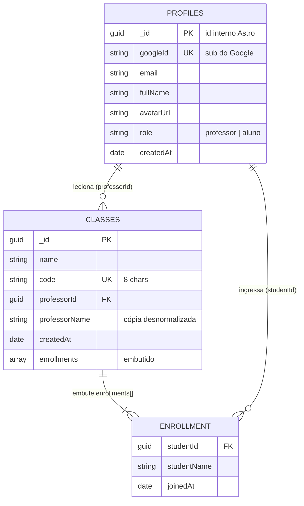
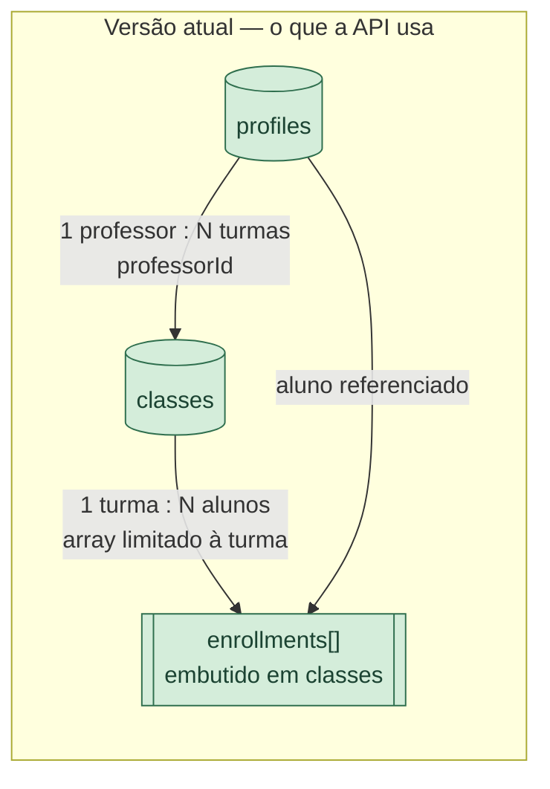
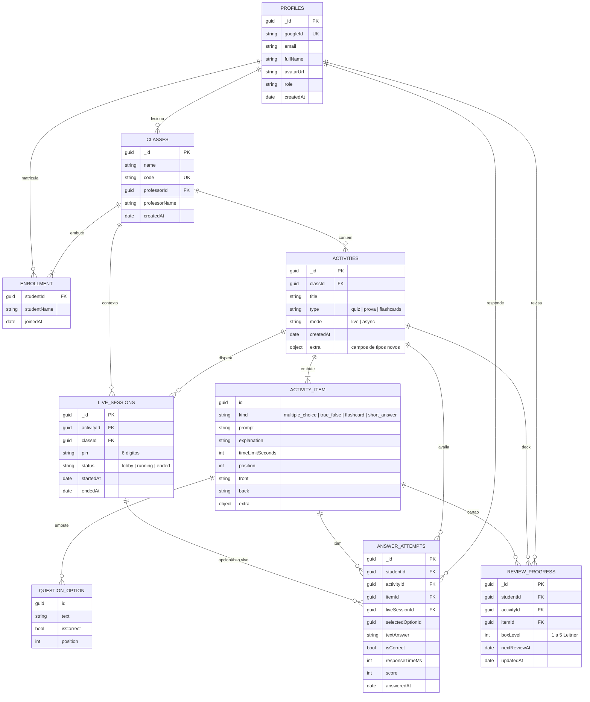
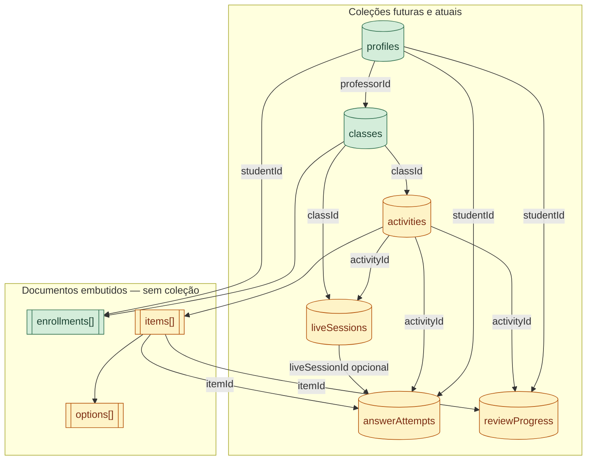
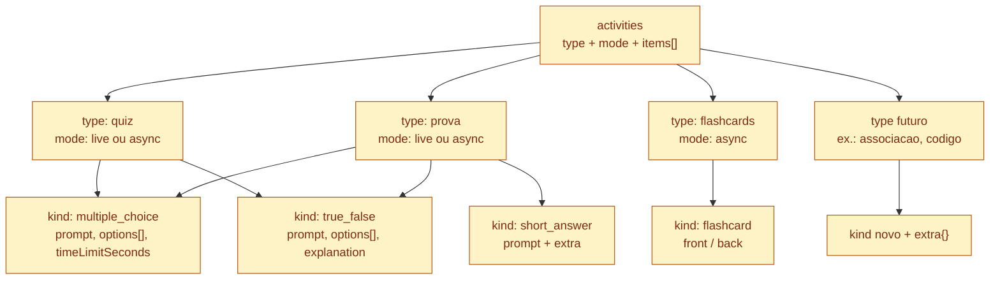

# Diagrama do banco de dados — Astro

O Astro usa **MongoDB Atlas** (banco `astro`), não um SGBD relacional. As “tabelas” abaixo são **coleções**. Relacionamentos são referências (`Guid`) ou documentos **embutidos**.

Legenda:

- **Verde** — coleção/campo em uso na versão atual
- **Âmbar** — previsto na versão futura (tipos e índices já existem no código)
- Losango **embutido** — vive dentro do documento pai (sem coleção própria)

---

## 1. Visão atual — coleções em uso

Hoje a API só lê e grava `profiles` e `classes`. Matrículas ficam **dentro** da turma (`enrollments[]`), no padrão documento: dados acessados juntos ficam juntos.





### Índices atuais

| Coleção | Índice | Motivo |
|---|---|---|
| `profiles` | `email` | busca / consistência |
| `profiles` | `googleId` unique sparse | login Google |
| `classes` | `code` unique | ingresso do aluno |
| `classes` | `professorId` | listagem do professor |
| `classes` | `enrollments.studentId` | listagem do aluno |

---

## 2. Visão futura — modelo completo

As coleções `activities`, `liveSessions`, `answerAttempts` e `reviewProgress` já estão declaradas em `MongoDbContext` e no domínio. A API REST correspondente ainda não existe.





---

## 3. Embutir versus referenciar

Decisões do modelo (padrão MongoDB: *data accessed together is stored together*):

| Relação | Cardinalidade | Estratégia | Por quê |
|---|---|---|---|
| Turma → matrículas | 1 : poucos/dezenas | **Embutir** em `classes` | Sempre listadas com a turma; turma escolar não explode o documento |
| Atividade → itens/opções | 1 : dezenas | **Embutir** em `activities` | Quiz/prova/flashcard é lido e editado como um todo; cabe em 16 MB |
| Professor → turmas | 1 : N | **Referência** `professorId` | Turmas são listadas e abertas sozinhas |
| Aluno ↔ turma | N : N | Ref. no array `enrollments` + índice | Consulta nos dois sentidos sem coleção-junção |
| Sessão ao vivo | 1 atividade : N sessões | **Referência** | Ciclo de vida próprio (lobby → ended) |
| Tentativas de resposta | ilimitado | **Coleção própria** | Cresce sem bound; analytics agrega à parte |
| Progresso Leitner | 1 por aluno+item | **Coleção própria** unique | Atualizado a cada revisão, independente do deck |

---

## 4. Polimorfismo de `activities` (versão futura)

Uma única coleção aceita quiz, prova, flashcards e tipos novos, sem migration. O discriminador é `type` no documento e `kind` em cada item. Campos extras entram em `extra` (`BsonExtraElements`).



### Exemplo de documento futuro — quiz

```json
{
  "_id": "…",
  "classId": "…",
  "title": "Sistema Solar",
  "type": "quiz",
  "mode": "live",
  "createdAt": "2026-08-13T00:00:00Z",
  "items": [
    {
      "id": "…",
      "kind": "multiple_choice",
      "prompt": "Qual o maior planeta?",
      "explanation": "Júpiter é um gigante gasoso.",
      "timeLimitSeconds": 30,
      "position": 0,
      "options": [
        { "id": "…", "text": "Marte", "isCorrect": false, "position": 0 },
        { "id": "…", "text": "Júpiter", "isCorrect": true, "position": 1 }
      ]
    }
  ]
}
```

### Exemplo de documento futuro — flashcard

```json
{
  "_id": "…",
  "classId": "…",
  "title": "Vocabulário — cap. 2",
  "type": "flashcards",
  "mode": "async",
  "items": [
    {
      "id": "…",
      "kind": "flashcard",
      "front": "Fotossíntese",
      "back": "Conversão de luz em energia química",
      "position": 0
    }
  ]
}
```

---

## 5. Índices previstos (já criados na subida da API)

| Coleção | Índice | Uso futuro |
|---|---|---|
| `activities` | `{ classId, type }` | listar quizzes/provas/flashcards da turma |
| `activities` | `{ classId, createdAt desc }` | linha do tempo da turma |
| `liveSessions` | `pin` | aluno entra na sala |
| `liveSessions` | `activityId` | sessões de uma atividade |
| `answerAttempts` | `{ studentId, activityId }` | histórico do aluno |
| `answerAttempts` | `{ activityId, itemId }` | analytics por questão |
| `reviewProgress` | `{ studentId, activityId, itemId }` unique | uma caixa Leitner por cartão |
| `reviewProgress` | `{ studentId, nextReviewAt }` | fila do dia |

---

## 6. Comparativo atual × futuro

| Coleção | Versão atual | Versão futura |
|---|---|---|
| `profiles` | login Google + role fixo | mesmo documento; vira âncora de tentativas e Leitner |
| `classes` | CRUD + matrícula embutida | ganha lista de `activities` por `classId` |
| `activities` | só no domínio / índices | editor do professor; itens polimórficos |
| `liveSessions` | só no domínio / índices | PIN, lobby, running, ended |
| `answerAttempts` | só no domínio / índices | ao vivo e assíncrono; score e tempo |
| `reviewProgress` | só no domínio / índices | Leitner 1–5 por aluno/item |

Não há tabelas-junção SQL. Relacionamentos N:N (aluno–turma, aluno–item) usam array embutido ou coleção de fatos (`answerAttempts`, `reviewProgress`) com referências e índice composto.
