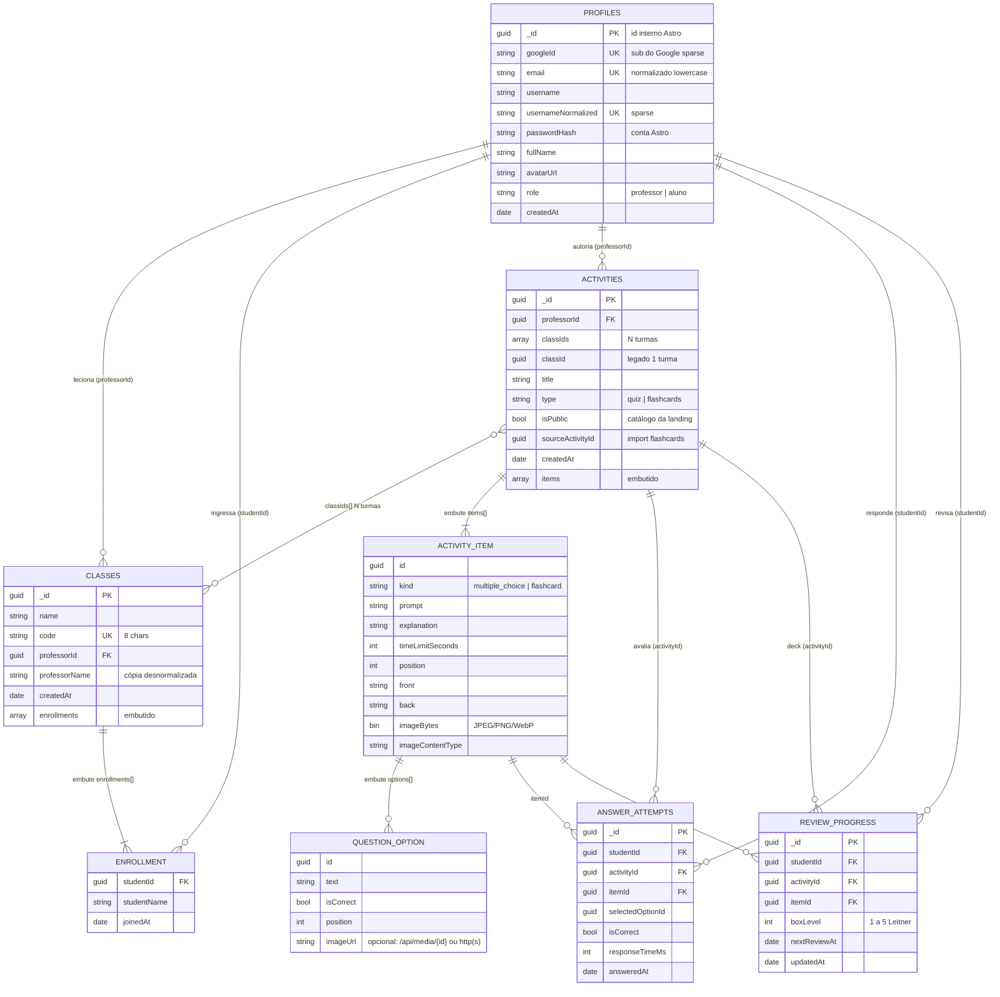
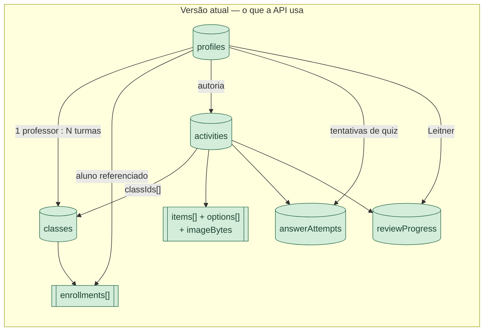
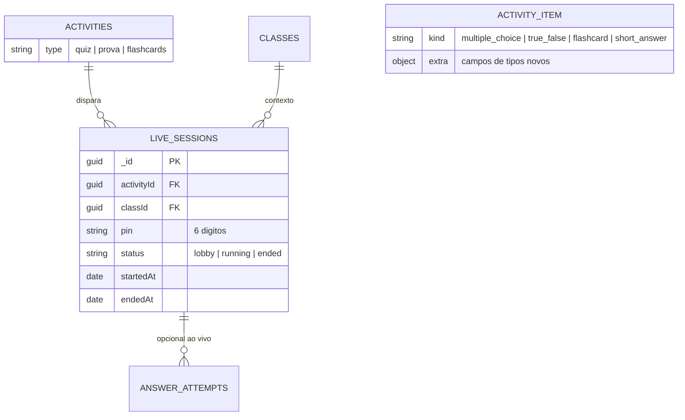
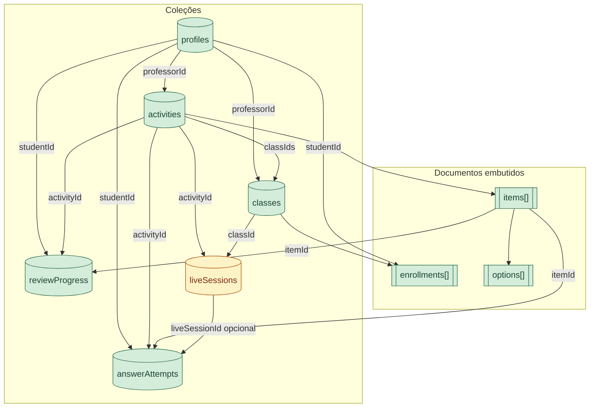
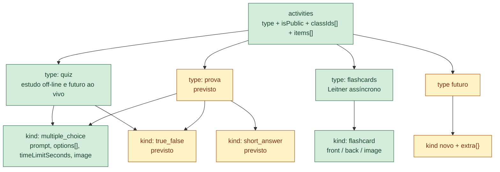
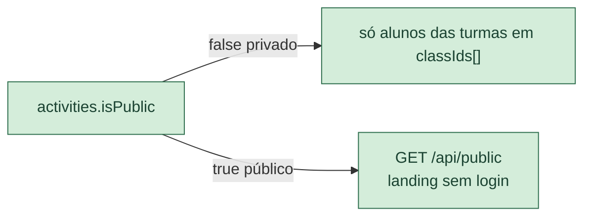

# Diagrama do banco de dados — Astro

O Astro usa **MongoDB Atlas** (banco `astro`), não um SGBD relacional. As “tabelas” abaixo são **coleções**. Relacionamentos são referências (`Guid`) ou documentos **embutidos**.

Legenda:

- **Verde** — coleção/campo em uso na versão atual
- **Âmbar** — previsto na versão futura (tipos e índices já existem no código)
- Losango **embutido** — vive dentro do documento pai (sem coleção própria)

---

## 1. Visão atual — coleções em uso

A API lê e grava `profiles`, `classes`, `activities`, `answerAttempts` e `reviewProgress`. Matrículas ficam **dentro** da turma (`enrollments[]`). Itens de quiz/flashcard (incluindo imagem em `BinData`) ficam **dentro** da atividade (`items[]`), no padrão documento: dados acessados juntos ficam juntos.

Limite de documento MongoDB: **16 MB**. Imagens são comprimidas no cliente e validadas no servidor.





### Índices atuais

| Coleção | Índice | Motivo |
|---|---|---|
| `profiles` | `email` unique (`email_unique`) | login e cadastro sem duplicata |
| `profiles` | `usernameNormalized` unique sparse | nome de usuário da conta Astro |
| `profiles` | `googleId` unique sparse | login Google |
| `classes` | `code` unique | ingresso do aluno |
| `classes` | `professorId` | listagem do professor |
| `classes` | `enrollments.studentId` | listagem do aluno |
| `activities` | `{ professorId, createdAt desc }` | biblioteca do professor |
| `activities` | `classIds` | atividades da turma |
| `activities` | `{ classId, type }` / `{ classId, createdAt desc }` | legado de 1 turma |
| `activities` | `{ isPublic, type, createdAt desc }` | catálogo público |
| `answerAttempts` | `{ studentId, activityId }` | histórico do aluno |
| `answerAttempts` | `{ activityId, itemId }` | analytics futuro por questão |
| `reviewProgress` | `{ studentId, activityId, itemId }` unique | uma caixa Leitner por cartão |
| `reviewProgress` | `{ studentId, nextReviewAt }` | fila do dia |

---

## 2. Visão futura — o que ainda não entra no fluxo

A coleção `liveSessions` já está no domínio e tem índices. O tipo `prova` e `kind` extra (`true_false`, `short_answer`) cabem no mesmo documento polimórfico, sem migration.





---

## 3. Embutir versus referenciar

Decisões do modelo (padrão MongoDB: *data accessed together is stored together*):

| Relação | Cardinalidade | Estratégia | Por quê |
|---|---|---|---|
| Turma → matrículas | 1 : poucos/dezenas | **Embutir** em `classes` | Sempre listadas com a turma; turma escolar não explode o documento |
| Atividade → itens/opções/imagem | 1 : dezenas | **Embutir** em `activities` | Quiz/flashcard é lido e editado como um todo; cabe em 16 MB com compressão |
| Professor → turmas | 1 : N | **Referência** `professorId` | Turmas são listadas e abertas sozinhas |
| Atividade ↔ turmas | N : N | Array `classIds` | O mesmo quiz/deck em várias turmas |
| Aluno ↔ turma | N : N | Ref. no array `enrollments` + índice | Consulta nos dois sentidos sem coleção-junção |
| Sessão ao vivo | 1 atividade : N sessões | **Referência** | Ciclo de vida próprio (lobby → ended) — futuro |
| Tentativas de resposta | ilimitado | **Coleção própria** | Cresce sem bound; estudo off-line já grava aqui |
| Progresso Leitner | 1 por aluno+item | **Coleção própria** unique | Atualizado a cada revisão, independente do deck |

---

## 4. Polimorfismo de `activities` (atual e futuro)

Uma única coleção aceita quiz, flashcards e tipos novos, sem migration. O discriminador é `type` no documento e `kind` em cada item. Campos extras entram em `extra` (`BsonExtraElements`).



Visibilidade:



### Exemplo de documento atual — quiz público

```json
{
  "_id": "…",
  "professorId": "…",
  "classIds": ["…"],
  "title": "Sistema Solar",
  "type": "quiz",
  "isPublic": true,
  "createdAt": "2026-08-16T00:00:00Z",
  "items": [
    {
      "id": "…",
      "kind": "multiple_choice",
      "prompt": "Qual o maior planeta?",
      "explanation": "Júpiter é um gigante gasoso.",
      "timeLimitSeconds": 30,
      "position": 0,
      "imageContentType": "image/jpeg",
      "imageBytes": "<BinData>",
      "options": [
        { "id": "…", "text": "Marte", "isCorrect": false, "position": 0 },
        { "id": "…", "text": "Júpiter", "isCorrect": true, "position": 1 }
      ]
    }
  ]
}
```

### Exemplo de documento atual — flashcard privado

```json
{
  "_id": "…",
  "professorId": "…",
  "classIds": ["…"],
  "title": "Vocabulário — cap. 2",
  "type": "flashcards",
  "isPublic": false,
  "createdAt": "2026-08-16T00:00:00Z",
  "items": [
    {
      "id": "…",
      "kind": "flashcard",
      "front": "Fotossíntese",
      "back": "Conversão de luz em energia química",
      "position": 0
    }
  ]
}
```

---

## 5. Índices da sessão ao vivo (já criados, uso futuro)

| Coleção | Índice | Uso futuro |
|---|---|---|
| `liveSessions` | `pin` | aluno entra na sala |
| `liveSessions` | `activityId` | sessões de uma atividade |

---

## 6. Comparativo atual × futuro

| Coleção | Versão atual | Versão futura |
|---|---|---|
| `profiles` | Google **e** e-mail/senha/usuário; role fixo | âncora de tentativas ao vivo e analytics |
| `classes` | CRUD + matrícula embutida | contexto da sessão ao vivo (`classId`) |
| `activities` | editor quiz/flashcards, imagens, `isPublic`, N turmas | tipo prova e `kind` adicionais |
| `answerAttempts` | quiz off-line autenticado | também ao vivo; score e `liveSessionId` |
| `reviewProgress` | Leitner 1–5 por aluno/item | mesmo documento |
| `liveSessions` | só no domínio / índices | PIN, lobby, running, ended |

Não há tabelas-junção SQL. Relacionamentos N:N (aluno–turma, atividade–turma, aluno–item) usam array embutido ou coleção de fatos (`answerAttempts`, `reviewProgress`) com referências e índice composto.
